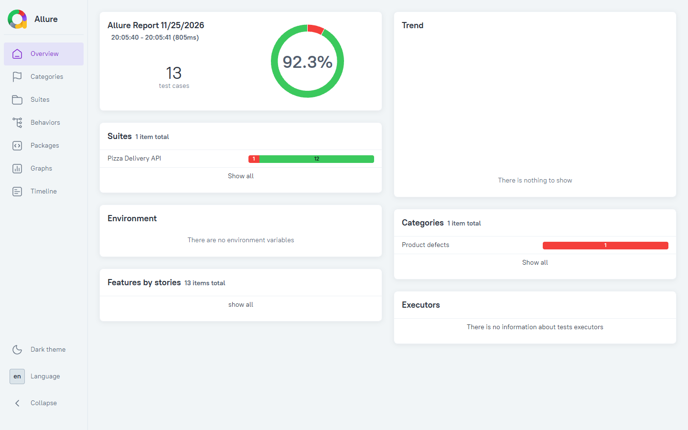

# Автотесты Pizza Delivery

## Требования

- Go 1.25 или новее.
- Docker Engine с Docker Compose.
- Allure Report 2 CLI в `PATH` и Java для сборки отчёта. [Установка Allure на Linux](https://allurereport.org/docs/v2/install-for-linux/)

## Запуск

Дождитесь ответа API со списком заказов.

```bash
docker compose up --build -d --wait db app
curl --retry 15 --retry-connrefused --retry-delay 1 --max-time 5 -fsS http://localhost:8080/orders
```

Перейдите в `api-tests` и запустите тесты. Для каждого прогона создаётся новая папка результатов, чтобы отчёт учитывал один запуск.

```bash
cd api-tests
mkdir -p allure-results
ALLURE_RESULTS_DIR="$(mktemp -d "$PWD/allure-results/run-XXXXXX")"
export ALLURE_RESULTS_DIR
go test -count=1 -v ./...
```

Тесты обращаются к `http://localhost:8080` по умолчанию. Для другого тестового экземпляра задайте `export API_BASE_URL=` перед запуском. 

Параметр `-run '^TestOrders$/^X$'` запускает только тест № X.

Каждый тест создаёт собственный заказ, если он нужен для сценария. После теста заказ удаляется через API, проверки списка используют UUID этого заказа. Запускайте набор на локальной или выделенной тестовой базе.

## Отчёт Allure

```bash
allure generate "$ALLURE_RESULTS_DIR" --clean --single-file -o allure-report
```

Откройте `allure-report/index.html` в браузере. Ещё можно использовать команду ниже.

```bash
xdg-open allure-report/index.html
```



## Сценарии

| № | Действие                                                                                                         | Ожидаемый результат |
| --- |------------------------------------------------------------------------------------------------------------------| --- |
| 1 | Создать заказ через `POST /orders` с индексом `1012` и двумя позициями 2 × Medium и 1 × Large.                   | `201`. `Location` равен `/orders/{id}`. Карточка содержит переданные адрес и позиции, статус `CREATED`, сумму `32.00`, валюту `EUR`, зону `CENTER` и `cancellationReason: null`. |
| 2 | Отправить `POST /orders` с `qty = 0` у одной позиции. Остальные поля валидны.                                    | `400` и объект ошибки. |
| 3 | Создать заказ с адресом без `apartment` и запросить `GET /orders/{id}`.                                          | `200`. Карточка совпадает с тестовыми данными, `apartment` равен `null`. |
| 4 | Создать заказ и запросить `GET /orders`.                                                                         | `200` и JSON-массив. В списке ровно одна запись с UUID тестового заказа и ожидаемыми статусом, суммой, валютой и зоной. |
| 5 | Запросить `GET /orders/{id}` с новым UUID, для которого заказ не создавался.                                     | `404` и объект ошибки. |
| 6 | Отправить `PATCH /orders/{id}/status` со статусом `PAID` для заказа в `CREATED`.                                 | `200` и карточка со статусом `PAID`. `GET` подтверждает, что статус сохранился. |
| 7 | Отправить `PATCH /orders/{id}/status` со статусом `DELIVERED` для заказа в `CREATED`.                            | `409` и объект ошибки. `GET` подтверждает исходный статус `CREATED`. |
| 8 | Отменить заказ в `CREATED` через `DELETE /orders/{id}?reason=…`, передав причину на русском с пробелами по краям. | `204` с пустым телом. `GET` возвращает `200`, статус `CANCELLED` и причину без крайних пробелов. |
| 9 | Отменить заказ и повторить `DELETE /orders/{id}?reason=…` с той же причиной.                                     | Повтор возвращает `204` с пустым телом. `GET` подтверждает `CANCELLED` и первоначальную причину. |
| 10 | Отправить `DELETE /orders/{id}` без параметра `reason` для заказа в `CREATED`.                                   | `400` и объект ошибки. `GET` подтверждает `CREATED` и `cancellationReason: null`. |
| 11 | Полностью удалить заказ в `CREATED` через `DELETE /orders/{id}/remove?reason=…` с валидной причиной.             | `204` с пустым телом. `GET /orders/{id}` возвращает `404`, в `GET /orders` UUID отсутствует. |
| 12 | Полностью удалить заказ и повторить тот же `DELETE /orders/{id}/remove?reason=…`.                                | Повтор возвращает `404` и объект ошибки. |
| 13 | Отправить `POST /orders` с оборванным JSON `{"address":`.                                           | `400` и объект ошибки. |

## Проверки структуры ответов

- Карточка заказа содержит `id` (UUID), `address`, массив `items`, строковые `status`, `currency`, `deliveryZone`, числовой `totalAmount` и `cancellationReason` со значением `null` или строкой. У адреса проверяются поля `city`, `street`, `house`, `postcode` (строки) и `apartment` (строка или `null`). У позиции проверяются `name`, `size` (строки) и `qty` (целое число).
- Список заказов представляет собой массив. У записи тестового заказа проверяются `id` (UUID), `status`, `currency`, `deliveryZone` (строки) и `totalAmount` (число).
- Объект ошибки содержит `timestamp` (дата и время в строке), `status` (целое число, равное HTTP-коду), `error` и `message` (непустые строки), `path` (путь запроса без query-параметров). Для JSON-ответов проверяется `Content-Type: application/json`, для `204` пустое тело.

## Структура проекта

- `orders_test.go` содержит сценарии. `fixtures_test.go` и `assertions_test.go` отвечают за подготовку, очистку и проверки.
- `internal/orders` содержит HTTP-клиент и модели запросов и ответов.
- `internal/config` содержит адрес API и таймаут.
- `internal/testdata` содержит фабрику заказов и ожидаемые значения.
- `internal/contract` содержит JSON Schema для карточки, списка и ошибок.
